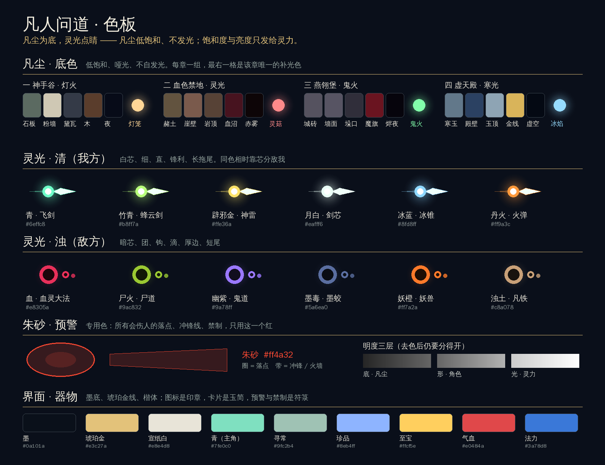

# 美术哲学

> **凡尘为底，灵光点睛。**

《凡人问道》的画面只讲一件事：**一个不起眼的凡人，走在一个不在乎他的世界里；这个世界里唯一发亮的东西，是灵力。**

这个凡人是玩家自己，不是韩立。修哪一门功法、走哪一条路——剑、法术、傀儡、灵虫、魔道、毒——都由玩家自己构筑。所以这套美术不能只为一种打法服务：它要让任何一种构筑都好看、好认，并且一眼分得出敌我。

这份文档是所有美术决定的依据。角色建模（含 Tripo 提示词）、场景、特效、界面都从这里推出来。色板见文末。

## 从世界观到法则

| 世界观里的事实 | 推出的法则 |
| --- | --- |
| 修仙界的一切差别，归根结底是灵力的差别：凡人与修士，低阶与高阶 | 一、光即灵力 |
| 功法千门万类，各有其气；斗法生死一线，认错一道光就会死 | 二、色相定流派，芯定敌我 |
| 玩家是凡人，出身寻常、资质寻常；修士斗法靠驭使法器，不靠拳脚 | 三、凡人本色 |
| 凡人如蝼蚁，天地广大而冷漠；修士各据一方洞天 | 四、盆景天地 |
| 境界越高，离人间烟火越远，同行的人越少 | 五、由暖入寒 |

## 参考坐标：《定海》《神舞幻想》与《暖雪》

三款游戏是我们的美术参照。只取**原则**，不取素材、角色、纹样原图或界面布局；下面每一条都写明"借什么、落在哪、不借什么"。依据是两款游戏的 Steam 商店页官方截图。

**《定海》**（俯视角动作 Roguelike，山海经与大禹治水）——和我们同一个镜头、同一种玩法，是场景与战斗画面的主要参照。

| 借什么 | 落在我们这里 | 状态 |
| --- | --- | --- |
| 战斗发生在一块嵌进地面的**青铜纹饰地台**上，纹样是器物上的云雷纹、夔纹，带绿锈和磨旧的金边 | 首领、精英、机缘、坊市、药园、奇遇、入口的房间中央都有一块地台：外圈云雷纹，内圈如意云头，中心一章一字（第四章是北斗星图）；寻常险地三成有，而且残破 | 已完成 |
| 地面是**有机的**：苔、落叶、花瓣、树根、碎石，没有一块干净的地砖 | 地面烘焙时撒成簇的落英（一章）、枯叶（二章）、余烬（三章）、霜花（四章）；墙根生苔 | 已完成 |
| 场景是**悬在云海上的盆景**：虬松、石灯、太湖石、天外垂落的飞瀑、远处的石柱 | 每间房坐落在一座削面石山上：南缘与东西两缘是裹住浮台的山石，北面是高出墙头的山脊，脊上有松与花树；云海里立着几根石柱，柱顶有树有灯，飞瀑垂落 | 已完成 |
| 标志性的**青铜构件与书画**：满布纹饰的巨环、悬在场景里的立轴山水 | 北门是一道青铜环门，环身满布云雷纹，两脚落在山石上；庭院与古殿的北墙上挂着随风轻摆的立轴（画是程序画的：远山三重、云气、一轮日、一方印） | 已完成 |
| 地面是**手铺的**：石板大小不一、缝里生苔 | 第一章的石板改为不规则四边形，每块明暗不同，受光的两条棱提亮、背光的两条棱压暗；其余三章各加了踏石树根、缺砖裂纹、鎏金菱花 | 已完成 |
| 环境低饱和、偏暗，**只有元素特效是高饱和的**（电蓝、毒绿、赤红、霜白） | 与"光即灵力"一致，不用改 | 已符合 |
| 界面极简：细血条、小圆图标，首领血条两端有云纹收头，连击数用毛笔字 | 首领血条收细，两端加云纹收头；五连以上在屏幕右侧显示毛笔字连击数（受伤清零，三十连转金、百连转竹青） | 已完成 |

**《神舞幻想》**（上古神话，祭祀歌舞）——是人物、礼器与光影气氛的参照。

| 借什么 | 落在我们这里 | 状态 |
| --- | --- | --- |
| **冷夜暖灯**：夜色偏青蓝，竹编灯笼与成串红灯是画面里唯一的暖色，萤火与花瓣在空中飘 | 第一章夜色调得更青，灯火保持暖黄；空中有萤火和落英（花瓣不发光，萤火发光） | 已完成 |
| **祭台**：巨大的圆形刻纹地面，刻着云纹与星图，逆光下只见剪影 | 第四章虚天殿的地台用鎏金北斗与周天星点 | 已完成 |
| **素衣银饰**：衣料素净（月白、青、绛），精工只集中在头、颈、腰三处——银冠、璎珞、流苏；点缀色是绿松石与珊瑚红 | 写进造型规范与 Tripo 提示词：衣料素、饰物精，饰物只在头颈腰 | 规范已写，模型待换 |
| 法术是**柔的**：花瓣、绸带、流光，而不是硬边的几何光效 | 非攻击性的术法用流光花瓣与绕身盘旋的绸带：服丹、升层、突破、开启机缘、银月的迷魂。攻击性神通仍按流派的"形"来 | 已完成 |

**《暖雪》**（俯视角动作 Roguelite，暗黑国风，飞剑）——和我们玩法最近，是明暗关系、笔触与战斗反馈的参照。

| 借什么 | 落在我们这里 | 状态 |
| --- | --- | --- |
| **黑暗里的一圈光**：场景大面积压黑，只有角色身边和烛火周围是亮的 | 以主角为中心，离得越远越暗（各章浓度不同）；主角身上的光加强，环境光略收 | 已完成 |
| **手绘的墨线**：物体都有一道深色的轮廓线 | 山石、树、石灯、屋顶、栏杆、角楼都描了一道墨线（合并后的网格沿平滑法线外扩、只画背面）；角色、妖兽、灵宠也描了（在屏幕空间里外扩，线宽不随模型大小变）。鬼物、火灵、晶石本身是一团光，不描。墨色随章节而变 | 已完成 |
| **战斗在地上留痕**：血迹不消失，打完一场，地上是一片狼藉 | 敌人倒下处留一摊墨渍，离开房间之前不消失：人与兽是暗绛，鬼物是墨，傀儡与晶石是碎屑 | 已完成 |
| **冷石暖烛**：成排的蜡烛是画面里唯一的暖色 | 屋内四角、北门两侧各有一簇蜡烛；机缘、坊市、药园、奇遇与入口的地台四周再围一圈 | 已完成 |
| 首领的场地有一个**占满地面的巨大母题** | 首领房的地台最大，中心是这位首领专属的纹样：墨大夫是太极，墨蛟是一条盘蛟，王蝉是一只张翅的蝉，极阴祖师是北斗与十二地支 | 已完成 |
| **羊皮纸与毛笔字的界面**：撕边的纸、朱砂印、稀有度发光 | 我们的界面是墨底金线，暂不改；可先给三选一的卡片加纸纹与撕边 | 待做 |

留痕的颜色是压暗的绛色，不闪、不成圆——和预警用的朱砂（亮、闪、规则的圆与线）不会混。

不借的东西：《暖雪》是二维手绘，我们是三维低面数，笔触感只能靠墨线和烘焙的明暗来做；它的血腥程度我们也不照搬。《定海》与《神舞幻想》是写实渲染、厚重材质，我们是 Q 版比例、平涂色块，不追求写实；《神舞幻想》的人物华丽，而我们的主角是凡人，布衣不变（见"凡人本色"）——华服银饰只给宗门高层、首领和有来历的 NPC。

### 场景造型语言

所有场景物件（山石、树、石灯、岛缘、远山）共用三条造型规矩，代码在 `js/scenery.js`：

1. **削面**：块体不做圆滑，每个面都是一刀切出来的。一块石头由二十面体细分一次、顶点沿径向随机伸缩而成，再压平顶与底。
2. **自下而上由暗到亮**：颜色烘在顶点上，根部压暗、顶部提亮，不靠灯光也有体积。
3. **朝上的面有"盖"**：第一章是苔，第二章是枯苔，第三章是灰，第四章是雪。盖只是零星几片（雪除外），石头的本色始终是主体——一块石头就是一座山。

树的画法：主干是几截渐细的枝干连成的一条歪线，侧枝末端各托一团叶。松的叶团是扁的云片，层层错开；花树与血枫的叶团是圆的。

| 章节 | 石 | 盖 | 树 |
| --- | --- | --- | --- |
| 七玄门 | 青灰 | 苔 | 松，偶尔一树桃花 |
| 血色禁地 | 赭石 | 枯苔 | 暗绛色的血枫（压暗过，避开预警用的朱砂） |
| 燕翎堡 | 玄石 | 灰 | 无 |
| 虚天殿 | 寒石 | 雪 | 无 |

### 地形：不是每张图都是"四面墙加四扇门"

《凡人修仙传》的故事发生在山谷、密林、洞窟、城池与古殿里，不是地牢。每间房有一个**地形**，决定它怎么围、怎么出入：

| 地形 | 怎么围 | 出口 | 用在哪里 |
| --- | --- | --- | --- |
| 院落 | 墙、屋顶、栏杆 | 门（北门是青铜环门） | 七玄门的屋舍、燕翎堡、虚天殿 |
| 山野 | 没有墙。一圈起伏的曲线围出一片不规则的空地，线外是林木与山石；地面一直铺到林子底下 | 一条土路从空地中央踩向出口，接一道**栈桥**通往对面的山头；路口两侧各立一只**火盆** | 血色禁地全章；七玄门约六成的险地与药园（山谷）；燕翎堡、虚天殿各约一半的险地 |
| 洞窟 | 四壁都是岩石，越往外越高，贴着空地处有石笋；没有天，没有云海，四周更黑 | **洞口** | 墨蛟的巢穴 |

**首领永远在北面。** 生成地图时，首领房一定位于它邻居的正北，所以通往首领的总是北面那道门：院落里是青铜环门；血色禁地里是立在一整面高岩壁上的洞门，岩壁越靠北越高、壁上长着树——这就是山洞的外景，穿过洞门才是墨蛟的洞窟。

地图之间靠路连着：通往洞窟的那个出口本身就是洞口（在北、东、西三面是立在岩壁上的洞门，东西两侧的略矮；在南面是地上一口向下的黑洞，洞沿围一圈矮石——因为镜头从南面看过来，立起来的洞门会挡住场内）。

各章的户外各不相同：

| 章节 | 户外是什么 | 地面 | 树 |
| --- | --- | --- | --- |
| 七玄门 | 山谷 | 草地、野花、黄土小径 | 松，偶尔一树桃花 |
| 血色禁地 | 密林 | 黑土、踏石、树根 | 暗绛色的血枫 |
| 燕翎堡 | 城外的焦土战场 | 焦黑的土、灰烬、裂纹、碎砖、零星的鬼火余烬 | 稀疏的、烧焦的枯树 |
| 虚天殿 | 殿外的雪原松林 | 蓝灰的雪、雪堆、冰面、脚印 | 压着雪的松（树冠顶白、底下偏蓝） |

山野的规矩：镜头从南面看，所以**紧贴空地南沿的一排只放矮石**，往外两排的树又小又疏、并且压暗；北面的树最高。

**大图。** 山野里的险地不是一屏，而是两到三屏：先把整张图填成林子，挖出中央一片、四周环绕五六片空地，每片都有小径连到中央，相邻的两片之间多半也连着，可以兜圈。敌人按空地埋伏——走进一片还没惊动过的空地，才引出下一波；至多四片有埋伏，其余是安静的。没有敌人时，画面上会标出最近一处"妖气"的方向。林子很厚，所以按离空地的远近分三档来画：贴着空地的一圈是整棵的树，往里两圈是简化的树，再深处只放一团团压暗的树冠。

**引导是隐式的。** 屏幕上平时没有地图（记录各处连通的舆图收着，按住 Tab 才展开），没有箭头，也没有带路的角色。该往哪走，靠颜色、地形和特效让人自己看出来：

| 手段 | 线索 | 暗示什么 |
| --- | --- | --- |
| 颜色 | **流光的颜色**：身边总有一缕光点顺着小径往前飘。金色的，前面是去路（出口、宝匣）；红色的，前面是敌人（埋伏、躲起来的残敌） | 往哪走，以及那边是什么 |
| 颜色 | **幡的颜色**：桥头的幡未解禁时暗沉；清场后，通往没去过的地方的变成亮金色，去过的褪成青灰 | 哪条路能走，哪条是新的 |
| 颜色 | **地面的明暗**：小径比两旁的地面亮；有埋伏的空地地面发黑 | 路在哪，哪里危险 |
| 地形 | **小径**：每片空地之间、每个出口到空地之间都有一条踩出来的土路 | 路往哪里通 |
| 地形 | **地标**：出口立着两根高出树冠的幡杆，隔着林子也望得见；小径中段立石灯；出口两侧有火盆 | 远处哪里是出口 |
| 特效 | **风向**：落花、萤火、孢子、飞雪整体朝要去的方向飘 | 大方向 |
| 特效 | **煞气**：有埋伏的空地上冒黑烟、夹红色火星 | 那里有敌人 |
| 特效 | **火盆与光柱**：出口的火盆未解禁时是熄的，清场后点燃；没去过的出口上方有一道淡光柱、火星升得更高 | 禁制解了，新路在那边 |

流光与风向指的是同一个目标，依次是：躲在看不见处的残敌（两秒多没有一个敌人在视线里时）、还没惊动的埋伏、没开的宝匣与传送阵、通往没去过的地方的出口。它们沿着能走的路指，不指隔着树林的直线方向；到了跟前、或者敌人就在眼前时，流光就停了。

规矩：引导只许是场景里本来就该有的东西（光、风、烟、火、幡、路），不许出现只为带路而存在的角色或界面标记。

**换图的过渡。** 不是一闪就到：走到出口，角色会沿着出口的方向继续走出去（上桥、进洞、出门），画面渐暗；到了下一张图，从对面的入口走进来，画面渐亮。出入口是成对的——从东边的桥离开，就从下一张图西边的桥上来。途中不受伤、不收输入。

### 层次：前景、中景、远景

一间房不是一块平地，而是从镜头到天边的五层。每一层的明度、清晰度各不相同，镜头一动，层与层之间会错开：

| 层 | 是什么 | 明度与处理 |
| --- | --- | --- |
| 前景 | 南面的岛缘山石、两角的高石与探进画面的树 | **压暗成剪影**（山石与树的颜色乘 0.4～0.55），不抢场内 |
| 场内 | 地面、地台、物件、角色 | **最亮、最清楚**。地面四周压暗，灯下有一圈暖光，物件脚下有接地影，云影缓缓移过 |
| 细部 | 墙根、石根处的草丛（枯草 / 碎砾 / 冰凌）与零星小花 | 贴地的一层小物，让墙和地之间不是一条硬线 |
| 中景 | 北墙、屋顶、墙后的山脊与树；东西两侧逐级下降的山台 | 被雾**推淡**：雾从场地中心开始起，越往北越淡、越偏雾色（空气透视） |
| 远景 | 云海里的石柱、飞瀑，两层流动的云海 | **云海是亮的**，石柱半融在雾里；深色的近景压在亮的远景上 |

另有两样东西隔在镜头与地面之间：顺着月光方向斜插进场内的几道光柱（很淡），和飘在墙根处的薄雾。

规矩：前景只能压暗，不能加细节；场内的亮度不让给任何一层；远景可以亮，但饱和度必须低。

### 墙与建筑

墙不再是贴图的长方体。四章各有各的围法，构件（瓦顶、立柱、栏杆、角楼、扶壁、垛口）都在 `js/scenery.js` 的 `Mo.archKit` 里，搭好后合并成一个网格：

| 章节 | 北 | 东西 | 南 | 四角 | 屋内隔墙 |
| --- | --- | --- | --- | --- | --- |
| 七玄门 · 庭院 | 粉墙，上覆黛瓦人字坡顶（瓦垄、正脊、鸱吻、翘起的檐角），墙前立檐柱 | 院墙上覆一道小瓦顶；门是两根立柱托着屋顶的门楼 | 石栏杆（望柱、寻杖），看得见栏外的山石；门两侧是带攒尖顶的门墩 | 攒尖顶角楼 | 假山，山上偶尔立一棵小松 |
| 血色禁地 · 密林 | 没有墙：一整圈都是山岩，北面最高，岩上长着血枫 | 山岩 | 矮岩 | 无 | 山岩 |
| 燕翎堡 · 围城 | 城墙、垛口、扶壁 | 城墙、垛口 | 矮城墙、垛口 | 角楼 | 残垣，上面压着碎石 |
| 虚天殿 · 古殿 | 玉墙、金脊，墙前立箍金环的玉柱 | 玉墙、金脊 | 玉栏杆 | 攒尖顶角楼 | 覆雪的冰岩 |

视线规矩不变：北面最高，东西居中，南面最矮，任何构件都不挡住场内。

地面：七玄门是手铺的不规则石板；血色禁地的泥地里有半埋的踏石和露出地面的树根；燕翎堡的城砖有缺砖和裂纹；虚天殿的金线交点处嵌鎏金菱花。

**地面上的小起伏。** 场内的地面在逻辑上是平的（走位、弹道都不受影响），但看上去不该是一张平板。所以凡是"面与面相接"的地方都垫一道矮矮的石条：墙根是两级台基，北门前是两级台阶，水池、熔池四周围一圈高出地面的石沿（虚天殿的是鎏金沿）。石条都低于脚踝，不挡人，只是让墙像是"立在台上"、水像是"凹下去的"。

### 场内的物件

场内的摆设和墙、树用同一套造型语言（削面、下深上浅、顶上落苔或落雪、合并后描墨线），不再有光滑的圆柱和圆球：

| 物件 | 做法 |
| --- | --- |
| 竹（七玄门） | 每竿三截、节上一圈深色的箍，越往上越向外弯；叶是一片片下垂的扁叶团 |
| 灵菇（血色禁地） | 骨白的伞盖底下垫一圈暗紫的伞沿，伞面缀几点青色灵光。**不用红**——朱砂只留给敌人的预警 |
| 火盆（燕翎堡、虚天殿） | 三足撑着束腰的铜盆，盆沿一圈金、两只立耳；火是两片削面的焰（燕翎堡是绿色鬼火，虚天殿是蓝色寒焰） |
| 战幡（燕翎堡） | 斜插在乱石里的破幡：幡面墨紫、镶暗金边，下摆撕成几绺、烧出几个洞。同样不用红 |
| 石像（虚天殿） | 拄剑而立的守殿人：两层石座、收腰的袍身，肩与头是削面的石块，雪自然落在肩头 |
| 冰晶（虚天殿） | 几根六棱冰锥从雪石里斜长出来，根上深蓝、尖上发白；半透明、自发光，不描墨线 |
| 残柱、瓦砾 | 断口参差的殿柱、倒在一旁的柱鼓；压着断梁的碎石堆 |

## 一、光即灵力

**法则：饱和度和亮度是一份预算，只发给灵力。**

- **凡尘**（地面、墙、布衣、凡人、凡铁）：低饱和、哑光、不自发光。大面积的东西一律如此，饱和度大致不超过 35%。
- **灵力**（法器、法术、灵药、灵石、禁制、阵法）：高饱和、自发光、带光晕。
- **境界越高，身上的光越多。** 第一章的野狼帮是凡人，射出来的箭都不发光；墨大夫只有那只银手是亮的；到极阴祖师，人几乎是黑的，光几乎是满的。
- **明度分三层**：底（凡尘，暗）、形（角色，中）、光（灵力，亮）。把画面去色，这三层仍然要一眼分得开。

这条法则顺带解决了可读性：凡是能交互、能伤人的东西都是灵力造物，天然是画面里最亮的，不需要额外的描边和箭头。

不做：给凡人山贼的刀加辉光；用高饱和色铺地砖；为了"好看"加彩色氛围灯。

## 二、色相定流派，芯定敌我

**法则：看颜色知道是哪一路功法，看芯知道是谁放的。**

玩家可以修任何流派，所以"我方用冷色、敌方用暖色"这类分法行不通——玩家修了魔道，放出来的也是血光。敌我和流派必须用两根互不相干的轴来表达。

### 色相定流派

每个流派有自己的颜色、形状和运动方式。玩家和敌人用同一套：敌方的剑修也是青的，敌方的魔修也是红的。

| 流派 | 色 | 形 | 动 | 已有内容 |
| --- | --- | --- | --- | --- |
| 剑 | 青 `#6effc8`（进到青竹一脉为竹青 `#b8ff7a`） | 细、直、锋利 | 快，直来直去，长拖尾 | 飞剑、青元剑阵、巨剑术、大庚剑阵、玄天斩灵剑 |
| 雷 | 辟邪金 `#ffe36a` | 折线、分叉 | 一闪即逝 | 辟邪神雷、风雷翅、天雷子、豹麟兽 |
| 火 | 丹火橙 `#ff9a3c` | 团、焰舌 | 飞出去，炸开 | 火弹术、三焰扇、紫罗极火 |
| 冰 | 冰蓝 `#8fd8ff` | 棱、锥 | 齐射，凝滞 | 冰锥术、乾蓝冰焰、青蛟旗、雪晶珠、六翼霜蚣 |
| 虫 | 铜金 `#e0b040` | 点、群 | 聚散，叮咬不放 | 噬金虫、血玉蜘蛛 |
| 傀 | 琥珀 `#ffbe5a` | 方、角、榫卯 | 一顿一顿，机械 | 傀儡术、人形傀儡 |
| 体 | 铁灰 `#c8d4e8` | 厚、圆 | 贴身 | 罗烟步、玄铁盾、混元钵、皇鳞甲、惊蛰十二变 |
| 魔 | 绛血 `#e8305a` | 弧、钩、滴 | 黏，缠 | 血影遁、血灵钻、血魔剑（还没有主修线） |
| 毒 | 瘴绿 `#9ac832` | 雾、泡 | 弥漫，滞留 | 待做（目前只有敌人在用） |
| 鬼 | 幽紫 `#9a78ff` | 飘、拖尾散 | 忽隐忽现，追人 | 鬼罗幡、啼魂兽、曲魂 |
| 土 | 赭黄 `#d0a858` | 块、柱、山 | 沉，自上压下、自下拔起 | 颠倒五行阵、土牢术、金光砖、元磁神山、土甲龙 |

### 芯定敌我

- **我方的芯是亮的（近白），敌方的芯是暗的（近黑）。** 外圈都是流派色。
- 我方的飞行法器带长拖尾；敌方的只有一圈厚边。
- 所以同样是血光：玩家修魔道放出来的是白芯红边，敌方魔修放出来的是黑芯红边。满屏弹幕时只需要记一条：**白芯的是自己的，黑芯的要躲。**

### 朱砂是预警专用色

所有会伤人的落点、冲锋线、火墙、禁制，在招式落下之前一律用朱砂红 `#ff4a32` 标出，不随流派变色。招式真正落下时才显出它自己的流派色。玩家只需要学会一件事：红的地方别站。

不做：让敌方弹幕带亮芯；让预警圈跟着招式属性换颜色；给某个流派一种"专属的敌我色"。

## 三、凡人本色

**法则：玩家的底子永远是布衣。流派不改变人，只改变他身边的器物和光。**

- **人朴素。** 不管修的是什么，玩家角色身上不发光、不长角、不披甲。流派写在他身边：剑修身后悬着飞剑，傀儡师身边跟着傀儡，虫修袖口有虫群进出。
- **身静器动。** 修士斗法靠的是驭使。人物的动作小而干净（并指、掐诀、侧身），所有夸张的运动交给法器去完成。
- **器随境进。** 法器的外形随功法进境而变，让成长看得见。飞剑从凡铁，到青元剑光，到青竹蜂云剑，是三把不一样的剑。
- **平日克制，一击尽出。** 普通攻击没有全屏效果。震屏和闪白只留给大事：自己受伤、首领的重招、境界突破，以及每个流派唯一的那一招"尽出"。
- **界面同理。** 战斗中的界面小而安静，不抢画面。

不做：主角周身环绕光环；按流派给主角换一整套造型；每次命中都震屏。

## 四、盆景天地

**法则：每个房间是云海里的一方盆景，人物是盆景里的小人。**

- **一景一物，其余留白。** 每间房只有一个主景（一株松、一丛竹、一盏石灯），地面至少七成空着。留白既是画意，也是走位的空间。
- **人小物大。** 镜头高而远。主角永远不是画面里最大的东西；首领、建筑、古树都要压过他。
- **Q 版人偶。** 人物约三到四头身、低模、手绘平涂、哑光，不用写实材质。这个比例在俯视镜头下最好认，也和"盆景里的小人"相称。
- **轮廓第一。** 俯视下最先看到的是头顶和肩。每个角色靠头部造型（发髻、斗笠、兜帽、面具）和手里的东西来辨认，而不是靠脸。
- **世界不迎合人。** 场景不为玩家摆出指引，没有发光的路标，雾外就是虚空。

不做：把房间塞满装饰物；给角色做写实的皮肤和金属质感；用特写镜头。

## 五、由暖入寒

**法则：四章是一条色温曲线。世界越来越冷，凡人始终是凡人。**

| 章 | 场景 | 补光 | 材质 | 含义 |
| --- | --- | --- | --- | --- |
| 一 | 神手谷 | 灯火（暖黄） | 粉墙、黛瓦、木 | 人间。最后一点烟火气 |
| 二 | 血色禁地 | 灵光（赤） | 赭土、岩、灵菇 | 荒野。第一次满眼灵物，也第一次满眼杀机 |
| 三 | 燕翎堡 | 鬼火（惨绿） | 城砖、铁、残旗 | 战火。浊光压过了一切 |
| 四 | 虚天殿 | 寒光（冰蓝） | 寒玉、金线、虚空 | 上古。处处是光，没有一处是暖的 |

- **月光是唯一不变的主光。** 四章都是夜，都有同一轮月。每章只换补光。
- **玩家的底色不变。** 从头到尾是那身布衣。世界在变，功法在变，人没变。

## 旗舰：青竹一脉

流派要一条一条做。最先打磨的是韩立所修的那一套——青元剑诀、青竹蜂云剑、辟邪神雷、噬金虫、风雷翅、傀儡——我们叫它**青竹一脉**。它是后面所有流派的标尺：别的流派做到什么程度算完成，就看有没有达到它的完整度。

母题只有三个：**竹**（剑身的竹节）、**青**（剑光）、**金雷**（辟邪神雷）。

| 功法 / 法宝 | 画面 | 状态 |
| --- | --- | --- |
| 飞剑 · 凡铁（炼气） | 铁色剑身，一线微光，短拖尾 | 已完成 |
| 飞剑 · 青元剑光（筑基，青元剑诀） | 月白剑身，青色剑芒，长拖尾 | 已完成 |
| 飞剑 · 青竹蜂云剑（结丹） | 竹节剑身、亮剑尖、金色剑格；剑身上游走金色电弧 | 已完成 |
| 悬剑 | 本命飞剑悬在身后，出剑时前指 | 已完成 |
| 青元剑阵 | 脚下青色阵图，环身飞剑各带拖尾 | 已完成 |
| 巨剑术 | 阵图锁定落点，光柱引路，巨剑自天而降 | 已完成 |
| 辟邪神雷 | 金色折线主干带分叉，落点金环与火花 | 已完成 |
| 蜂云剑阵（尽出） | 七十二口竹青小剑分三圈旋出，先成阵、再散开追敌；剑与剑之间游走电弧；双层阵图 | 已完成 |
| 大庚剑阵（尽出 · 进阶） | 七十二口飞剑剑尖朝下环立成阵，缓缓绕行；地上青、金两层阵图反向旋转；阵中万千剑丝往复穿梭，命中时拉出一道亮丝；收阵时阵图坍缩，辟邪神雷逐个劈落 | 已完成 |
| 风雷翅 | 一对银蓝羽刃光翼，金、蓝两道雷痕 | 已完成 |
| 噬金虫 | 金银相间的甲虫，振翅 | 已完成 |
| 玄铁盾 | 六角玄铁盾牌绕身飞旋，一层薄薄的护体灵光 | 已完成 |
| 傀儡术 | 机关傀儡，琥珀色弩矢 | 傀儡本体待重做 |
| 乾蓝冰焰、掌天瓶 | 各自的触发特效 | 待做 |

### 法宝与灵宠

法宝和灵宠越多，画面越容易乱。它们守三条规矩：

1. **法宝只在出手的一瞬间亮**。自动祭出的法宝平时不上屏，出手时才现形，打完就收；落点不用朱砂（朱砂只属于敌人），只画一圈流派色的细环。常驻身边的只有三样：混元钵、皇鳞甲的鳞光、紫罗极火。
2. **灵宠是凡尘的一部分**。身体低饱和、不发光，脚下踩着和主角同色的青环，表示是自己人；只有出手时才带上流派色的光（霜蚣的冰锥、豹麟兽的电弧、啼魂兽的幽紫声浪）。
3. **只有"尽出"可以铺满屏幕**。大庚剑阵是全场唯一允许盖住大半个屏幕的我方特效；元磁神山、玄天斩灵剑这类至宝可以大，但只能停留不到半秒。

| 类别 | 画面 | 状态 |
| --- | --- | --- |
| 金光砖 / 元磁神山 / 天雷子 | 实体自天而降（金砖、石山、雷珠），落点一圈流派色细环 | 已完成（几何体） |
| 乌龙夺 / 青蛟旗 / 八灵尺 / 鬼罗幡 / 三焰扇 | 去而复返的乌钩；由走过的位置连成身子的青蛟；向八方奔出的兽灵；追人的鬼头；赤金蓝三色焰扇 | 已完成（弹幕形态），法宝本体的模型待做 |
| 血魔剑 / 黑风旗 / 玄天斩灵剑 | 绛血弧光；漆黑的空间裂缝镶幽紫边；白炽芯的巨大剑光 | 已完成 |
| 混元钵 / 皇鳞甲 / 紫罗极火 | 绕身的铜钵；金色鳞光；环身升腾的紫焰 | 已完成 |
| 颠倒五行阵 / 土牢术 | 阵图上五色灵光流转；一圈石柱拔地而起 | 已完成 |
| 灵宠灵虫 | 血玉蜘蛛、六翼霜蚣、土甲龙、银月、啼魂兽、豹麟兽、人形傀儡是几何体拼的；曲魂借用铁奴的模型 | 可用，待用 Tripo 重做 |

### 后续流派

每个新流派要做齐四样东西，才算和青竹一脉对等：

1. **本命法器**：普通攻击的形态（剑修是飞剑；魔修、毒修、傀儡师各自是什么）。
2. **进境三态**：炼气、筑基、结丹三个阶段，法器各换一次形。
3. **神通若干**：按上表的色、形、动来做。
4. **尽出一招**：这个流派唯一允许铺满屏幕的特效。

## 造型规范

| 阵营 | 底色 | 点缀 | 轮廓 | 发光处 |
| --- | --- | --- | --- | --- |
| 玩家（默认形象） | 青灰布衣 | 白领、发带 | 高髻、直身 | 身上不发光；光在身边的法器上 |
| 凡俗武林（野狼帮、铁奴） | 麻褐、土灰 | 一条红头巾 | 斗笠、头巾、短打、刀弓 | 无 |
| 墨大夫 | 灰袍 | 白须 | 佝偻、瘦 | 仅银手 |
| 正道宗门（掩月宗等） | 素色长袍，一门一色 | 白领、玉佩 | 发髻、广袖、直线 | 仅法器 |
| 魔道（鬼灵门、魔焰门、血侍） | 黑 | 一种流派色 | 兜帽、面具、弯钩、尖角 | 眼、法器、纹路 |
| 尸与傀儡 | 铜绿、铁锈、木 | 符纸黄 | 方、厚、僵直 | 眼、符 |
| 妖兽 | 兽类本色 | 一处警戒色 | 楔形、团块 | 仅警戒处（眼、螯、花芯） |
| 元婴老怪（极阴祖师） | 近黑 | 无 | 枯、瘦长 | 周身光最盛 |

通用规则：每个角色不超过三种颜色；兵器握在右手；不做底座。

### 衣料素，饰物精

人物身上的精工只放在三处：**头**（冠、簪、抹额）、**颈**（璎珞、项圈）、**腰**（带扣、玉佩、流苏）。衣料本身是素的，一件衣服至多两种颜色加一道滚边。饰物的材质按身份分：

| 身份 | 饰物 | 点缀色 |
| --- | --- | --- |
| 凡人、散修、玩家 | 布带、木簪、麻绳，没有金属 | 无 |
| 宗门弟子 | 一件小银饰（发扣或带扣） | 宗门色的滚边 |
| 长老、首领、有来历的 NPC | 银冠 / 青铜冠、璎珞、流苏齐全 | 绿松石、珊瑚红 |
| 魔道 | 黑铁、兽骨，尖而带钩 | 流派色的眼与纹路 |

## 界面

界面是储物袋里的东西，不是浮在画面上的塑料按钮。

- **墨底、琥珀金线、楷体。** 数字用无衬线体，保证战斗中看得清。
- **图标是印章**：圆框里一个字。神通和法宝的卡片右上角盖一枚流派印，颜色就是该流派的色相。
- **卡片是玉简**；预警与禁制是**符箓**（朱砂）。
- 稀有度沿用三色：寻常（灰青）、珍品（蓝）、至宝（金）。

## 新资产五问

加任何一个模型、特效、界面元素之前，过一遍：

1. 它发光吗？发光的理由是灵力吗？
2. 去色之后，它还待在自己该在的那一层（底、形、光）吗？
3. 它属于哪个流派？色、形、动对上了吗？
4. 它是谁放的？芯画对了吗？
5. 俯视下缩到六七十像素高，还认得出来吗？

## 色板

色板由 `tools/make-palette.py` 生成。

## 现状对照

已经符合的：

- 四章的场景配色与补光，全程夜景；房间是云海浮台，物件稀疏。
- 敌我之芯：我方弹幕白芯带拖尾，敌方暗芯厚边。
- 预警统一为朱砂；敌方招式的颜色归入各自流派。
- 青竹一脉的法器与特效（见上表）。
- 震屏只留给大事。
- 玩家默认形象（Tripo 模型）：布衣、高髻、身上不发光。
- 界面的墨底金线、楷体、印章式图标，卡片上的流派印。

还不符合、接下来要做的：

| # | 问题 | 违反 | 改法 |
| --- | --- | --- | --- |
| 1 | 主修功法只有青元剑诀一条线，筑基时自动习得，玩家没得选 | 自由构筑的前提 | 第二条主修线做出来之后，筑基与结丹处改为择一 |
| 2 | 魔、鬼、土、傀等流派只有神通、法宝和灵宠，没有主修线；毒还没有任何玩家内容 | 自由构筑的前提 | 按"后续流派"的四样东西逐个做 |
| 2b | 自动祭出的法宝只有弹幕形态，法宝本体（旗、扇、尺、幡）没有模型；灵宠是几何体 | 造型规范 | 用 Tripo 生成后替换 |
| 3 | 其余人形角色是西式奇幻模型（骑士盔、熊头帽） | 造型规范 | 按阵营规范重写 Tripo 提示词，逐个替换 |
| 4 | 傀儡、妖兽、鬼物仍是几何体拼的 | 盆景天地（造型统一） | 用 Tripo 生成后替换 |
